<picture>
  <source media="(prefers-color-scheme: dark)" srcset="assets/header-dark.svg">
  
</picture>

### `whoami`

I'm Muktanan, a Master's student in Computer Science at ITER, Siksha 'O' Anusandhan, in Bhubaneswar. My thesis teaches models to read ECGs from several hospitals without a single recording leaving the hospital that took it, which explains the heartbeat up there. Most of what's left of my attention goes to Formula 1. I'd like to do data science at Ferrari one day, so for now I'm modelling pit-stop strategy in [what-the-pit-wall-knew](https://github.com/tinySage/what-the-pit-wall-knew), one race at a time.

Away from code, I write. [briocheclub](https://muktamohapatra.substack.com) is my Substack, where I post essays, silly poems and recommendations for whatever I've been reading or watching. The essays tend to wander off toward folklore or dark energy, and my shelf runs from *The Poppy War* to *Project Hail Mary*, with *Jujutsu Kaisen* somewhere in between.
